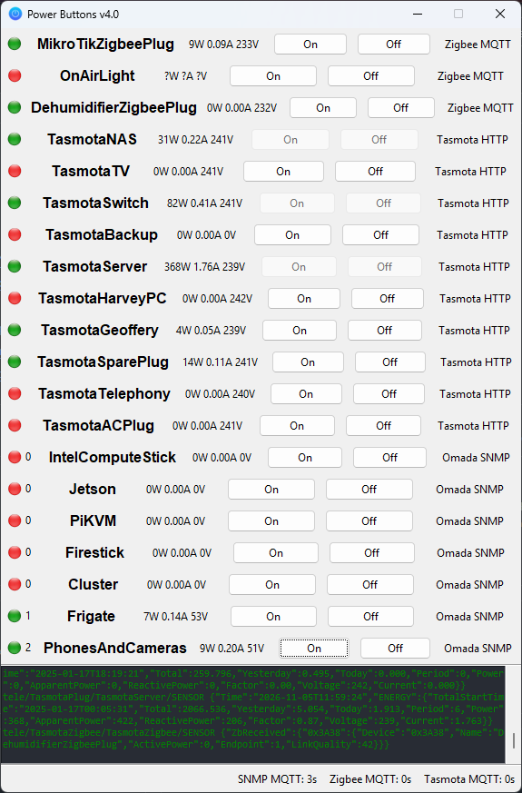

# HomelabPowerButtons
Simple GUI for toggling the power of stuff in my house.

- Interlinks with [HomelabPowerLogger](https://github.com/jwansek/HomelabPowerLogger) MQTT
- Toggles and reads Tasmota-flashed power smart plugs with MQTT and the HTTP API
- Toggles and reads Omada POE switches with (SNMP), MQTT and the HTTP API
- Toggles and reads Sonoff Zigbee smart plugs with a Tasmota-flashed zigbee controller and MQTT
